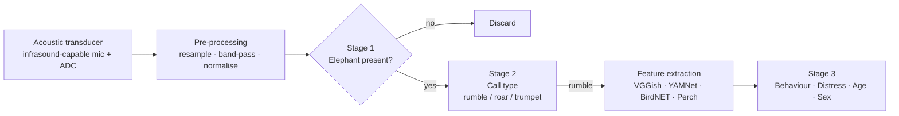

# Acoustic Transducer–Based Detection of Elephant Behavioural Patterns

**Final Year Project · IEE UG '27**

| | |
|---|---|
| **Team** | _Name 1 (Roll No.)_, _Name 2 (Roll No.)_, _Name 3 (Roll No.)_ |
| **Guide** | _Prof. / Dr. Name_, Department of _____ |
| **Institute** | _Institute name_ |
| **Academic year** | 2026–27 |

---

## Abstract

Elephants communicate largely through low-frequency rumbles, many of them in the infrasonic range (below 20 Hz). This project aims to design an acoustic transducer system whose recordings can be used to work out what elephants are doing (separation, competition, affiliation, nursing and so on), and to estimate the caller's age, sex and level of distress.

The signal-processing and classification pipeline is built on transfer learning. Four pre-trained audio networks (VGGish, YAMNet, BirdNET, Perch) turn each vocalisation into a feature vector, and lightweight classifiers predict behaviour and demography from those features.

We train and evaluate on **359 field-labelled recordings** from the Dzanga-Bai clearing, Central African Republic, collected by the Elephant Listening Project. Test splits keep each recording session separate from training. All tasks score clearly above chance:

| Task | Classes | Macro-F1 | Random guess |
|---|---|---|---|
| Behaviour | 5 | **0.37** | 0.21 |
| Distress | 2 | **0.64** | 0.48 |
| Age | 4 | **0.53** | 0.25 |
| Sex | 2 | **0.72** | 0.52 |

---

## Problem statement

> Design and develop an acoustic transducer whose signals and information are used to detect the behavioural patterns of elephants.

### Objectives

1. Define the acoustic requirements of a transducer that can capture elephant vocalisations, including infrasonic rumbles.
2. Build a processing pipeline that turns raw recordings into features suitable for machine learning.
3. Train and evaluate classifiers that predict **behavioural context**, **distress**, **age** and **sex** from those features.
4. Evaluate honestly: no information from the test recordings may leak into training, and every model is compared with a chance baseline.

---

## System overview



This repository's main contribution is **Stage 3**: behaviour and demography classification. Stages 1 and 2 are planned (see [Future work](#future-work)).

### Transducer design requirements

These requirements come from the acoustics of elephant calls and from the format of the training data:

| Parameter | Requirement | Reason |
|---|---|---|
| Low-frequency response | Flat down to about 5 Hz | Rumble fundamentals are around 10–20 Hz |
| Sample rate | ≥ 4 kHz (8 kHz preferred) | Matches the 4 kHz pipeline the models were trained on; covers roar and trumpet harmonics |
| Bit depth | ≥ 16 bit | Rumbles can be faint at distance |
| Deployment | Weather-proof, long-duration autonomous recording | Forest and field monitoring |

---

## Dataset

### What we used

The repository includes acoustic features computed by the original authors from the full Dzanga-Bai dataset (`outputs/*_vocalisation_features.parquet`). It also includes the field-observed labels in `data/`.

| File | Contents |
|---|---|
| `data/elephant_vocalisations.csv` | 1,254 annotated calls: start and end time, frequency range, call type (rumble, roar or trumpet) |
| `data/elephant_contextual_observations.csv` | 359 recordings, each with behaviour, distress, age and sex |
| `outputs/*_vocalisation_features.parquet` | Feature vectors for all 1,254 calls from VGGish (128-d), YAMNet (1,024-d), BirdNET (1,024-d) and Perch (1,280-d) |

The behaviour labels were made by Elephant Listening Project observers who watched the elephants at the time of recording, so they are genuine ground truth.

### What we did not use, and why

| Source | Why it was not used for behaviour |
|---|---|
| The 10 sample `.wav` files | Too few to split into training and test sets; the first attempt scored 0.00 |
| Web and YouTube elephant clips and ESC-50 clips (added to `audio_dir/`) | No behaviour labels. The 601 × 30 s chunks most likely come from one 5-hour video, which would leak between training and test. All elephant clips are MP3 and all others WAV, a shortcut a model could learn. Web clips have lost the infrasonic range. |
| [HiruDewmi elephant-sound dataset](https://github.com/HiruDewmi/Audio-Classification-for-Elephant-Sounds) | Labelled by call type only. All 359 behaviour-labelled recordings are rumbles, so knowing the call type cannot tell behaviours apart. |
| Other public datasets (Samburu, LDC Asian elephant, Pardo et al.) | Lack structured behaviour labels, need a licence fee, or include no audio |

These sources remain useful for the **Stage 1 detector** and the **Stage 2 call-type model**. The full reasoning is in the [project report](Elephant_Behaviour_Classification_Report.pdf).

---

## Methodology

1. **One example per recording.** Behaviour labels belong to the recording, not to each call, so the features of all rumbles in a file are averaged.
2. **Class filtering.** Unknown labels are removed. *Sexual* (8 recordings) and *Anti-Predator* (2) are too rare to learn and are excluded.
3. **Leak-free evaluation.** We use 5-fold `StratifiedGroupKFold` grouped by recording session (`opp_###`), so 219 sessions never appear on both sides of a split. The whole run is repeated with 3 seeds.
4. **Models.** We compare Logistic Regression, RBF SVM (with PCA) and Random Forest on each feature set and on all four combined, plus a random-guess baseline.
5. **Metric.** Macro-F1 gives every class equal weight. Balanced accuracy is also reported.

---

## Results

| Task | n | Best model | Features | Macro-F1 | Chance | Accuracy |
|---|---|---|---|---|---|---|
| Behaviour | 323 | Logistic Regression | BirdNET | 0.372 ± 0.005 | 0.208 | 51% |
| Distress | 141 | Logistic Regression | All four combined | 0.641 ± 0.038 | 0.482 | 65% |
| Age | 328 | Random Forest | BirdNET | 0.530 ± 0.004 | 0.246 | 65% |
| Sex | 314 | RBF SVM | All four combined | 0.720 ± 0.013 | 0.515 | 74% |

**Behaviour, F1 per class:**

| Separation | Competition | Affiliation | Nursing | Logistics |
|---|---|---|---|---|
| 0.64 | 0.54 | 0.44 | 0.16 | 0.12 |

**Key findings**

- Rumbles carry behavioural information. Separation, Competition and Affiliation are recognised well above chance.
- Nursing (24 recordings) and Logistics (15) are the weakest classes. Most Nursing calls are predicted as Competition, which shows the need for more labelled data.
- Sex and age are easier to predict than behaviour, which fits with body size shaping the voice.

The confusion matrices, the full results table and the trained models are in `outputs/behaviour_classification/`.

---

## Repository structure

```
├── 1_feature_extraction_notebook.ipynb     # Extract CNN features from annotated calls
├── 2_call_types_notebook.ipynb             # Do features separate rumble / roar / trumpet?
├── 3_behaviour_demography_notebook.ipynb   # UMAP + statistics on behaviour and demography
├── 4_behaviour_classification.py           # ★ Supervised behaviour / distress / age / sex classifiers
├── Elephant_Behaviour_Classification_Report.pdf   # ★ Dataset decisions and results
├── Project_Architecture_and_Roadmap.pdf    # ★ Full system architecture, transducer design, next steps
├── 142512.pdf                              # Reference paper: Kahoro & Muriithi (ICAART 2026)
├── requirements-classifier.txt             # ★ Minimal packages for the classifier (Setup A)
├── requirements.txt / pyproject.toml / uv.lock   # Full environment (Setup B)
├── audio_dir/              # 10 sample recordings from Dzanga-Bai
├── data/                   # Call annotations and contextual (behaviour) labels
├── elephant_scripts/       # Pre-processing, model wrappers, plotting, statistics
└── outputs/
    ├── *_vocalisation_features.parquet     # Pre-computed features (all 1,254 calls)
    └── behaviour_classification/           # ★ CV results, confusion matrices, trained models
```

★ = added in this project.

---

## How to run

There are two ways to set up the project. Most people only need **Setup A**.

| | Setup A: classifier only (recommended) | Setup B: full project |
|---|---|---|
| Runs | `4_behaviour_classification.py` (all results in this README) | Everything above, plus notebooks 1–3 |
| Installs | 7 small packages, no TensorFlow | Everything, including TensorFlow and librosa |
| Download / disk | ≈ 150 MB / ≈ 500 MB | ≈ 1 GB / ≈ 3 GB |
| Time | about 5 min to install, 2–5 min to run | 10–20 min to install |

### Before you start

1. **Install Python 3.12.** Use 3.12 exactly: 3.13 and 3.11 will fail, because the pinned `numpy 1.26.4` has no wheels for them.
   - **Windows:** download it from [python.org](https://www.python.org/downloads/release/python-31210/) and tick **"Add python.exe to PATH"** in the installer.
   - **macOS:** `brew install python@3.12`
   - **Ubuntu:** `sudo apt install python3.12 python3.12-venv`

   To check the install, run `py -3.12 --version` (Windows) or `python3.12 --version` (macOS/Linux). It should print `Python 3.12.x`.
2. **Install Git** from [git-scm.com](https://git-scm.com/downloads), or download the repository as a ZIP instead.
3. Make sure you have **at least 1 GB free** on the drive where Python installs packages. On Windows, that is usually C:.

### Step 1: Get the code

```bash
git clone https://github.com/<your-username>/elephant_transfer_learning.git
cd elephant_transfer_learning
```

If you don't have Git: on the GitHub page, click **Code → Download ZIP**, extract it, and open a terminal inside the extracted folder.

> Every command below must be run **from inside this folder**, the one that contains `README.md` and `4_behaviour_classification.py`.

### Step 2 (Setup A): Create an environment and install the packages

**Windows (PowerShell or Command Prompt):**
```powershell
py -3.12 -m venv .venv
.venv\Scripts\python -m pip install --upgrade pip
.venv\Scripts\python -m pip install -r requirements-classifier.txt
```

**macOS / Linux:**
```bash
python3.12 -m venv .venv
.venv/bin/python -m pip install --upgrade pip
.venv/bin/python -m pip install -r requirements-classifier.txt
```

These commands call the environment's Python directly (`.venv\Scripts\python`), so you don't need to "activate" anything. That also avoids the PowerShell *"running scripts is disabled"* error.

### Step 3: Run the classifier

**Windows:**
```powershell
.venv\Scripts\python 4_behaviour_classification.py
```

**macOS / Linux:**
```bash
.venv/bin/python 4_behaviour_classification.py
```

### Step 4: Check the output

The script prints one line per model as it trains. It ends with a summary like this:

```
### Behaviour: best = ... (macro-F1 0.3x vs chance 0.20)
...
Saved results, confusion matrices and fitted models to: ...\outputs\behaviour_classification
```

It also creates these files in `outputs/behaviour_classification/`:

| File | What it is |
|---|---|
| `cv_results.csv` | Scores for every task, feature set and classifier |
| `confusion_behaviour.png`, `confusion_distress.png`, `confusion_age.png`, `confusion_sex.png` | Confusion matrices |
| `best_<task>_model.joblib` | The best model for each task, trained on all labelled data |

The script needs no audio files, GPU or internet connection, because it uses the pre-computed features in `outputs/`.

### Setup B: Full project, including the notebooks

Install [uv](https://docs.astral.sh/uv/getting-started/installation/), then run these from the project folder:

```bash
# install uv
#   Windows:     powershell -ExecutionPolicy ByPass -c "irm https://astral.sh/uv/install.ps1 | iex"
#   macOS/Linux: curl -LsSf https://astral.sh/uv/install.sh | sh

uv sync                                         # creates .venv with the exact versions in uv.lock
uv run python 4_behaviour_classification.py     # same classifier as Setup A
uv run --with jupyterlab jupyter lab            # opens the notebooks in your browser
```

Notes for the notebooks:
- **Notebook 3** works offline using the pre-computed features.
- **Notebook 1** downloads VGGish, YAMNet and Perch from TensorFlow Hub and Kaggle, so it needs internet. For BirdNET, download the model from [BirdNET-Analyzer](https://github.com/birdnet-team/BirdNET-Analyzer) into `elephant_scripts/models/BirdNET_GLOBAL_6K_V2.4_Model/`. Only the 10 sample recordings are included, so it demonstrates the pipeline rather than recomputing every feature.
- In VS Code, you can instead open a notebook and select the `.venv` interpreter as the kernel.

### Google Colab (no installation)

Upload or clone the repository into Colab, then run:

```python
%cd /content/elephant_transfer_learning
!pip install -q -r requirements-classifier.txt
%run 4_behaviour_classification.py
```

Colab uses Python 3.12, so the same pinned versions work. The confusion matrices appear inline.

### Troubleshooting

| Problem | Fix |
|---|---|
| `py` is not recognised (Windows) | Reinstall Python 3.12 with **"Add to PATH"** ticked, or use the full path, e.g. `C:\Users\<you>\AppData\Local\Programs\Python\Python312\python.exe -m venv .venv` |
| `No matching distribution found for numpy==1.26.4` | You are on the wrong Python version. Delete the `.venv` folder and recreate it with Python **3.12**. |
| `There is not enough space on the disk` or `MemoryError` | Free up space on C: (Windows also needs free disk space to manage memory). Clearing old package caches can help: `py -3.12 -m pip cache purge` or `uv cache clean`. |
| `FileNotFoundError: ... yamnet_vocalisation_features.parquet` | You are not in the project folder. `cd` into the folder that contains `outputs/`, then run the script again. |
| PowerShell says *"running scripts is disabled"* | Use the `.venv\Scripts\python ...` commands exactly as written above. They don't need activation. |
| Your numbers differ slightly from this README | Check you installed the pinned versions from `requirements-classifier.txt`. Other versions of scikit-learn give slightly different scores. |

---

## Limitations

- **Single site:** all labelled data comes from one forest clearing (Dzanga-Bai) and one species (*Loxodonta cyclotis*).
- **Small, imbalanced classes:** Nursing, Logistics, Infant and Distress have few examples.
- **Fixed features:** the provided features cannot be re-processed. Recordings from a new transducer must pass through the same pipeline (4 kHz, band-pass, same networks) before these models can be applied.

## Future work

- Request the full audio and annotations from the Cornell Elephant Listening Project to grow the rare classes.
- **Stage 1 detector:** elephant vs. background, using the collected elephant clips and ESC-50, with splits grouped by source.
- **Stage 2 call-type model:** using the HiruDewmi dataset plus the 1,254 annotated calls.
- Build and field-test the transducer prototype against the requirements above, then validate the full pipeline end to end.
- Explore fine-tuning the feature extractor on elephant audio, and running it on an edge device for real-time monitoring.

---

## Acknowledgements and credits

This project builds on the open-source code and data released with:

> Pickering, A. et al. (2025). *A scalable transfer learning workflow for extracting biological and behavioural insights from forest elephant vocalizations.* Remote Sensing in Ecology and Conservation. [doi:10.1002/rse2.70008](https://zslpublications.onlinelibrary.wiley.com/doi/full/10.1002/rse2.70008)

The recordings and behavioural annotations come from the **Elephant Listening Project**, K. Lisa Yang Center for Conservation Bioacoustics, Cornell University (Dzanga-Bai, CAR, Sept 2018 – Apr 2019). The full audio dataset is available from the original authors on request.

Other resources:
- Piczak, K. J. (2015). *ESC: Dataset for Environmental Sound Classification* (ESC-50).
- [HiruDewmi / Audio-Classification-for-Elephant-Sounds](https://github.com/HiruDewmi/Audio-Classification-for-Elephant-Sounds) (Sensors 2025, doi:10.3390/s25020352).
- Pre-trained models: VGGish and YAMNet (Google), BirdNET (Cornell / TU Chemnitz), Perch (Google).
